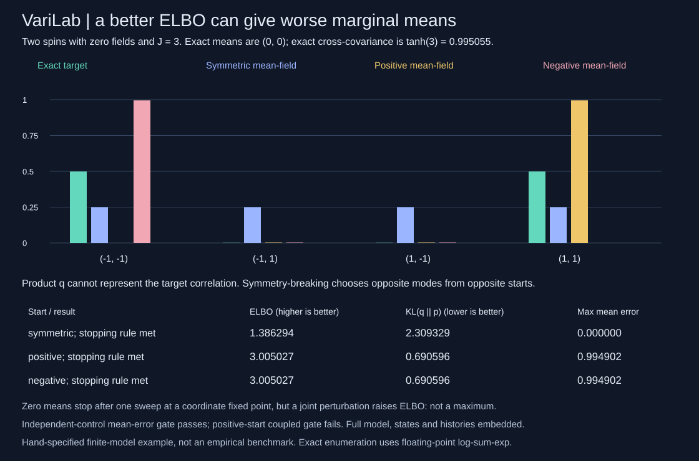
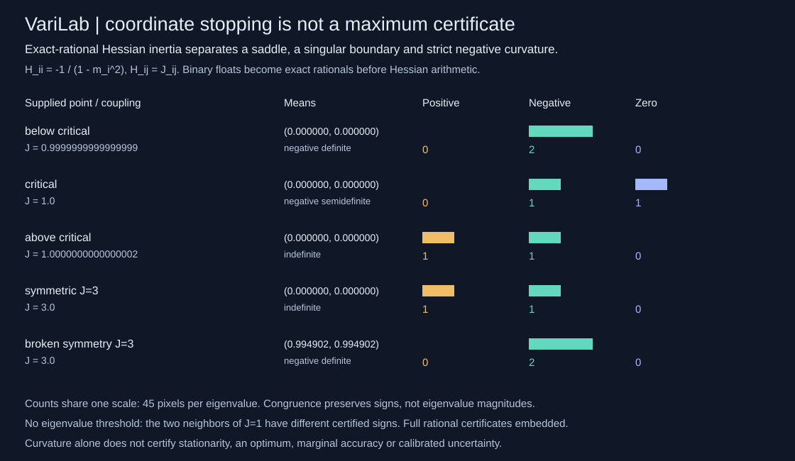
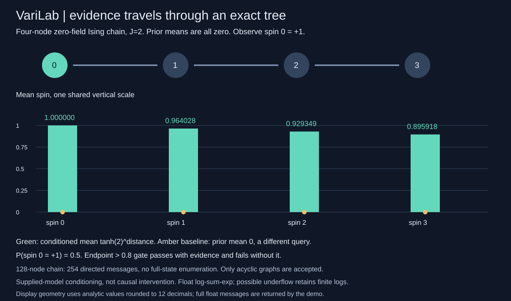

# VariLab

Mean-field variational inference from scratch, with an exact finite-state reference and an objective-versus-marginal failure audit. Dependency-free Python 3.10+.

VariLab solves **small supplied Ising distributions**, not a data-fitting or posterior-learning problem. It enumerates every binary spin state in log space, then fits a product distribution by sequential coordinate ascent. Every coordinate update is recorded. The ELBO, independently summed reverse KL, exact means and missing correlations stay visible.



## Better objective, worse marginal means

```sh
python -m varilab demo
python -m unittest discover -s tests -v
PYTHONPATH=. python examples/render_audit.py --check
```

The directly specified two-spin target has zero fields and coupling `J=3`: aligned states have almost all the mass, split equally between `(-1,-1)` and `(1,1)`. Each exact mean is zero; cross-covariance is `tanh(3) = 0.995055`. Three mean-field runs differ only in their initial means, using the same ascending coordinate order, 100-sweep cap and `1e-12` sweep-change tolerance.

| Initial means | Final means | ELBO, higher is better | KL(q against p), lower is better | Maximum mean error | Sweep-change stopping rule |
|---|---|---:|---:|---:|---|
| `(0,0)` | `(0,0)` | 1.386294 | 2.309329 | 0.000000 | Met after 1 sweep |
| `(.1,.1)` | `(.994902,.994902)` | 3.005027 | 0.690596 | 0.994902 | Met after 7 sweeps |
| `(-.1,-.1)` | `(-.994902,-.994902)` | 3.005027 | 0.690596 | 0.994902 | Met after 7 sweeps |

The positive and negative starts give a higher ELBO and lower reverse KL, yet worse marginal means. A product family cannot represent the target correlation. All three product distributions have zero off-diagonal covariance. The zero start stops at a coordinate fixed point with zero residual, **not an ELBO maximum**: a small joint positive perturbation raises the ELBO. A stopping rule is not a global-optimality or marginal-accuracy certificate.

The independent control has fields `(.4,-.7,.2)` and no edges. Its fitted means match `tanh(fields)` to floating precision. The `max_mean_error <= 1e-6` gate passes for that control and fails for the positive-start coupled run. The demo asserts both outcomes; it does not require a control to perform poorly. These first hand-specified fixtures, `J=3` and starts `0,+.1,-.1`, were not chosen by a parameter, seed or checkpoint search. This is a constructed counterexample, not an empirical benchmark or an inference-method ranking.

## Exact-rational curvature certificates



```sh
python -m varilab curvature-demo
python -m varilab curvature examples/coupled.json --means '[0,0]'
PYTHONPATH=. python examples/render_curvature.py --check
```

`curvature(model, means)` audits the ELBO Hessian at **supplied interior means**. Its diagonal is `-1/(1-m_i*m_i)` and its off-diagonal entries are supplied couplings. It converts the compiled binary-float means/couplings to exact fractions *before* computing that formula. Symmetric rational congruence returns the full Hessian `H`, invertible transformation `T`, block diagonal `D`, pivot blocks, exact positive/negative/zero eigenvalue counts and rational positive/negative quadratic-form witnesses where those signs exist. The certificate identity is `T^T H T = D`. All rational entries are JSON objects with integer `numerator` and positive `denominator`.

| Supplied two-spin point | Positive / negative / zero counts | Curvature |
|---|---:|---|
| `m=(0,0)`, `J=nextafter(1,0)` | 0 / 2 / 0 | Negative definite |
| `m=(0,0)`, `J=1` | 0 / 1 / 1 | Negative semidefinite |
| `m=(0,0)`, `J=nextafter(1,2)` | 1 / 1 / 0 | Indefinite |
| `m=(0,0)`, `J=3` | 1 / 1 / 0 | Indefinite |
| Existing positive-start `J=3` fitted point | 0 / 2 / 0 | Negative definite |

No eigenvalue tolerance turns the adjacent representable couplings into the same answer. At `J=3,m=0`, the returned positive-curvature direction is `(3,1)` with exact quadratic form `8`; the float gradient is zero, and the existing joint-perturbation test independently shows an ELBO increase. The broken-symmetry point has strict negative curvature, but its stationarity is only numerically checked, not exact. **Curvature alone does not certify a maximum**, model accuracy, or calibrated uncertainty. Singular curvature is reported without a higher-order conclusion. Congruence preserves eigenvalue signs, not their magnitudes; pivot entries are not eigenvalues.

Unlike the finite-state reference, this curvature calculation is rational arithmetic on the represented point. It does not invoke state enumeration or fitting. It rejects endpoint means; Hessian derivatives are not finite there. Dimension remains capped at 12; elimination uses cubic rational-operation work and quadratic storage, with variable integer bit cost, not a runtime promise. No spectral condition number, exact gradient, optimizer convergence proof or interval enclosure of uncertain inputs is claimed.

## Exact sum-product on forests, with evidence



```sh
python -m varilab forest-demo
python -m varilab forest examples/coupled.json --evidence '[{"i":0,"spin":1}]'
PYTHONPATH=. python examples/render_forest.py --check
```

`forest(model, evidence=[{'i': 0, 'spin': 1}])` is a separate two-pass log-domain sum-product implementation for **acyclic supplied models with 1..128 spins**. It returns all conditional singleton marginals, all four joint-state probabilities per stored edge, edge moments/covariances, component roots and log partitions, every directed message with its source dependencies, unconditional log partition, and evidence probability/log probability. Singleton states are ordered `[-1,+1]`; edge states are `(-1,-1),(-1,+1),(+1,-1),(+1,+1)`. Messages are unnormalized log subtree sums, not probabilities. The original enumeration, fitting and curvature APIs keep their 12-spin limits.

A directly specified four-node zero-field chain with `J=2` has zero prior means. Observing spin 0 as `+1` gives conditional means `1, 0.964028, 0.929349, 0.895918`, analytically `tanh(2)^distance`, with evidence probability `0.5`. The endpoint-mean `>0.8` gate passes with evidence and fails for the prior query. Ignoring evidence is intentionally a **different query**, not a weak inference baseline or a method ranking. A 128-node chain returns 254 directed messages without enumerating `2**128` states. The demo includes its complete messages and marginals, not a timing/speedup claim.

Evidence is a list of distinct records containing exactly integer `i` and integer `spin` in `{-1,+1}`. Hard evidence clamps the named spins; it does not remove edges or perform a causal intervention. Finite potentials give every consistent evidence assignment positive mathematical probability. Underflowed possible probabilities keep finite logs. Forbidden clamped singleton/edge states have probability zero and null log probability. The API does not clip or relabel roundoff as exact normalization. Cycles, including zero-weight cycles, are rejected **before messages**, not silently handled as loopy belief propagation. Disconnected forests and isolated nodes are supported.

Model schema, finite magnitude limits of 100 and duplicate-edge checks match the other APIs, with a 128-spin cap only on the forest path. The shared compiler retains the original public 12-spin validation. Iterative traversal avoids recursion-depth dependence. There are exactly `2*edge_count` messages per pass. Cavity sums are deliberately recomputed, and each trace records dependencies, so actual arithmetic/output accounting is `O(n + sum_i degree_i^2)`, at most quadratic under this cap; no linear-time implementation claim is made. Evidence requires a second unconditional pass to compute its normalizer. Matrix-sized all-pair marginals, cyclic models, arbitrary factors, MAP decoding and learned structure are not implemented.

The forest figure uses the fixed analytic small-chain means rounded to 12 decimals for portable display geometry, not float messages serialized as byte-exact certificates. Its metadata states this boundary and includes exact fixture inputs, gates and selection. Full float-message outputs are available in `forest-demo`; they are checked numerically, not used for sign certificates.

## Model and calculations

For spins `z_i` in `{-1,+1}`, the target is proportional to:

```text
exp( sum_i h_i*z_i + sum_(i,j) J_ij*z_i*z_j )
```

The model has one finite field per coordinate and a list of undirected edges, stored once with `i < j`. No self-edge, duplicate edge or temperature convention is inferred. To use an inverse temperature, put it into the supplied fields and weights yourself. No parameter learning is implemented.

The product family has means `m_i` and probabilities `q(z_i=+1)=(1+m_i)/2`. Its ELBO is expected log potential plus the sum of Bernoulli entropies. With all other coordinates fixed, the maximizing update is:

```text
m_i <- tanh(h_i + sum_j J_ij*m_j)
```

Updates are **sequential**, using newly changed earlier coordinates. Synchronous/Jacobi updates are not implemented or claimed to be monotone. Coordinate order is explicit. The analytic interior ELBO gradient is `h_i + sum_j J_ij*m_j - atanh(m_i)`; endpoints have undefined derivatives and are rejected by the gradient API, while entropy and fitting accept endpoint means.

For this normalized target, `log_partition - ELBO = KL(q against p)`. `compare` computes the left side from the analytic product ELBO and the right side independently by summing every product state against the exact target's log probability. This audit does not make the product family expressive enough to recover correlations or both modes.

## API and strict JSON CLI

```python
from varilab import exact, mean_field, compare, elbo, elbo_gradient, curvature, forest
model = {
    'version': 1,
    'fields': [0, 0],
    'edges': [{'i': 0, 'j': 1, 'weight': 3}],
}
truth = exact(model)
fit = mean_field(model, initial=[.1, .1], sweeps=100,
                 tolerance=1e-12, order=[0, 1])
audit = compare(model, initial=[.1, .1], tolerance=1e-12)
objective = elbo(model, [.2, -.3])
gradient = elbo_gradient(model, [.2, -.3])
geometry = curvature(model, [0, 0])
conditioned = forest(model, evidence=[{'i': 0, 'spin': 1}])
```

```sh
python -m varilab exact examples/coupled.json
python -m varilab fit examples/coupled.json --initial '[0.1,0.1]'
python -m varilab compare examples/coupled.json --initial '[0.1,0.1]'
```

- `exact`: canonical supplied model, every ordered spin state and its probability/log probability, log partition, exact-enumeration means, second moments and covariance. The rightmost spin changes fastest. Underflowed displayed probability retains a finite log probability; it is not a structural zero.
- `mean_field`: initial/final means, positive-spin probabilities, product covariance, analytic ELBO/entropy/expected log potential, settings, every coordinate snapshot including the initial state, completed sweeps/update count, last-sweep maximum change, stopping-rule status and final maximum coordinate residual. History means are independent snapshots.
- `compare`: both records, full product state probabilities/logs, directly summed reverse KL, the ELBO gap and maximum absolute mean error. An impossible product state has zero mass and null log probability. Exact target states always have finite log probability.

Default initialization is all zeros, order is ascending, cap is 100 sweeps and tolerance is `1e-10`. The stopping rule is maximum absolute coordinate movement **during the last full sweep** at most tolerance. It is not merely net start/end movement. A reached sweep cap reports `stopping_rule_met=false`; no earlier checkpoint or run is silently selected. Reverse KL means `KL(q || p)`, not `KL(p || q)`.

## Validation and resource bounds

Models require exactly `version`, `fields`, `edges`; version is integer 1. There are 1..12 spins, field and edge magnitudes at most 100, and all numbers must be finite and not booleans. Edge endpoints are integer `0 <= i < j < n`, with no repeats. Means must match the dimension and lie in `[-1,1]`; order must be a full integer permutation. Sweeps are integer 1..1,000; tolerance is finite in `[0,1]`.

Exact enumeration is capped at `2**n * (n + edge_count + n*n) <= 786432`. Fitting preflights the conservative requested cost `sweeps*n*(n+edge_count) <= 500000`, before creating history. These operational counts omit constant factors and integer/control overhead; they are not elapsed-time guarantees. `compare` preflights both before running either branch. Zero-weight edges are still counted.

JSON files are capped at 256 KiB. Duplicate keys, nonfinite values, unknown fields, malformed inputs and inconsistent dimensions are errors. CLI errors exit 2, without partial JSON or a traceback. Runtime and tests use only the standard library. Outputs do not mutate model/settings inputs or global random state; no RNG is used.

## Evidence, limits and attribution

87 tests include analytic independent/two-spin references, direct exponential enumeration on 216 three-spin models, all pair moments, independent product-state ELBO/KL sums, finite differences for every gradient coordinate, one-coordinate exhaustive objective scans, every-update ascent/history reconstruction, symmetry/permutation checks, zero-start nonmaximum, the objective-versus-mean counterexample, lost covariance, saturated/underflow arithmetic, validation, input/RNG isolation, actual exact-work boundary and preflight rejection, CLI equality/errors and four figure tests. 20 added curvature/API/CLI tests verify exact congruence and witness reconstruction, a 729-matrix independent characteristic-polynomial inertia oracle, 1x1/2x2 and singular pivots, finite-difference Hessians, binary-neighbor sign boundaries, coordinate permutations, 12-spin and near-endpoint cases, input isolation and validation. Four added curvature-figure tests verify all 15 count bars and complete certificates. The original figure tests inspect all 16 bars and nine table values, full unchanged metadata, regeneration and rejection of changed fixtures.

For the state reference, "exact" means full finite-state enumeration using floating-point log-sum-exp, **not rational or outward-rounded arithmetic**. Tiny numerical KL or covariance errors are possible. Saturated `tanh` values become product point masses. There is no proof of a global mean-field optimum, no exact arbitrary-dimensional posterior inference, observation conditioning, parameter learning, mixture variational family, stochastic optimization, MCMC, calibrated uncertainty or deployment claim.

The ELBO/KL identity and mean-field coordinate principle are standard, following [Blei, Kucukelbir and McAuliffe (2017), sections 2.2-2.4](https://www.cs.columbia.edu/~blei/papers/BleiKucukelbirMcAuliffe2017.pdf). The Ising reduction, implementation, synthetic fixtures, independent test references and figures here are original. No paper text, code or external dataset is bundled. MIT licensed. No network, API key, paid service, model download or GPU is needed.

Curvature inertia follows [Sylvester's law and block congruence, explained by Nick Higham (2022)](https://nhigham.com/2022/12/06/what-is-the-inertia-of-a-matrix/). The rational elimination, certificate format, witnesses and boundary fixtures are independent implementations, not copied code. See [DESIGN.md](DESIGN.md) for the proof and arithmetic boundary.

The curvature figure/demo fixes the captured broken-symmetry means to the binary floats `0.9949015284526289` rather than refitting during rendering. It embeds the complete rational certificate but omits the separate libm-dependent float gradient diagnostic, which remains available in the API. This keeps byte regeneration portable without rounding or weakening exact sign checks.

25 forest/API/CLI tests cover 324 directly enumerated conditioned three-spin cases, independent directed-message subtree sums, analytic long-chain/star partitions, singleton/edge consistency, rare-evidence underflow logs, disconnected/isolated/full-evidence cases, schedule dependencies, permutation/isolation, cycle/size validation and unchanged original bounds. Four forest-figure tests verify the displayed bars/baselines, explicit rounded metadata and regeneration. Sum-product follows [Zemel and Urtasun, CSC412 exact inference lectures (2016), tree message passing and log-domain normalization](https://www.cs.toronto.edu/~duvenaud/courses/csc412/lectures/05-exactInference.pdf). Code, supplied examples and independent test oracles are original.
